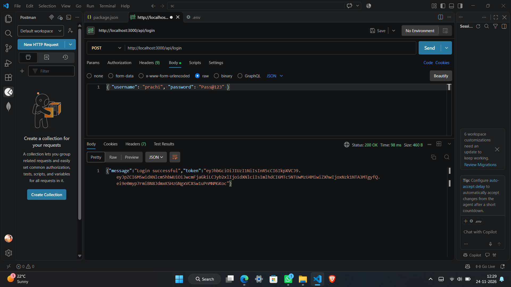
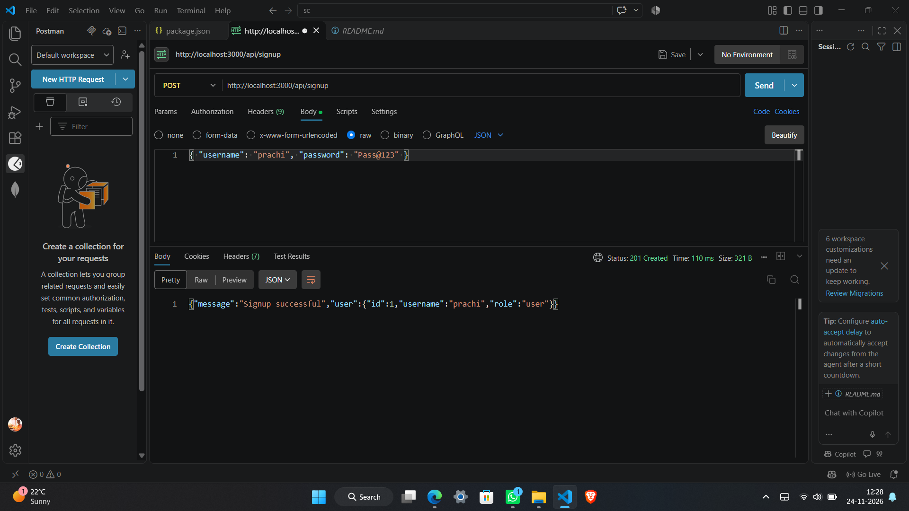

# Secure Connect
npm install && npm start  → http://localhost:3000

POST /api/signup {username,password,role?}
POST /api/login → {token}
GET  /api/profile | /api/admin/users (admin)   [Bearer token]
CRUD /api/notes                                [Bearer token]
Chat: open http://localhost:3000 in two tabs

## Expected Output

![Fig 1]
*Fig 1. Signup response (201 Created)*

![Fig 2]
*Fig 2. Login response with JWT token (200 OK)*

![Fig 3]
*Fig 3. Notes API accessible with a valid JWT (200 OK)*
.png>)